<!--
**Ariestootl/Ariestootl** is a ✨ _special_ ✨ repository because its `README.md` (this file) appears on your GitHub profile.

Here are some ideas to get you started:

- 🔭 I’m currently working on ...
- 🌱 I’m currently learning ...
- 👯 I’m looking to collaborate on ...
- 🤔 I’m looking for help with ...
- 💬 Ask me about ...
- 📫 How to reach me: ...
- 😄 Pronouns: ...
- ⚡ Fun fact: ...
-->

---

<!--
# 💫 About Me:
-->

  

<!-- <h1 align="center">⚡Hello, I'm Aries👋⚡ </h1> -->

# 👩‍💻 About Me

## 👨‍🏫 Current Role
**Lecturer** | Institute of Mathematics, College of Science, University of the Philippines Diliman

## 🎓 Education
* 🎯 **Doctor of Philosophy (Ph.D.) in Data Science** | **2025 – Present**  
  *Data Science Program, College of Science, University of the Philippines (UP) Diliman*
* 📜 **Master of Science (M.Sc.) in Applied Mathematics** | **2023 – 2025**  
  *Institute of Mathematics, College of Science, University of the Philippines (UP) Diliman*
* 📜 **Bachelor of Science (B.Sc.) in Marine Transportation** | **2013 – 2018**  
  *Maritime Academy of Asia and the Pacific*

## 🏫 Academic Affiliation
**[Numerical Analysis Scientific Computing (NASC) Group](https://math.upd.edu.ph/research/numerical-analysis-and-scientific-computing)** | Institute of Mathematics, UP Diliman

## 🧪 Research Interests
* ⚙️ **Scientific Machine Learning:** (e.g. Physics-Informed Neural Networks (PINNs/PIKANs), Inverse Problems in Partial Differential Equations, Mean Curvature Flow (MCF))
* 🧠 **Neural Networks & Artificial Intelligence:** (e.g. Deep Learning Architectures, Kolmogorov–Arnold Networks (KANs), MLPs)
* 📐 **Optimization:** (e.g. Gradient-based Methods, Non-Convex Optimization, Saddle Point Escape Mechanics, Operations Research)
* 📊 **Data Science:** (e.g. Statistical learning, Applied Data Analytics, Explainable AI (XAI))

# 🌐 Socials:
   

# 💻 Language and Tools
            

# 📊 Stats:
<!--
 
-->
---

<picture data-importer="pacman">
  <source media="(prefers-color-scheme: dark)" srcset="https://raw.githubusercontent.com/Ariestootl/Ariestootl/pacman-output/pacman-contribution-graph-dark.svg?game=pacman">
  <source media="(prefers-color-scheme: light)" srcset="https://raw.githubusercontent.com/Ariestootl/Ariestootl/pacman-output/pacman-contribution-graph.svg?game=pacman">
  
</picture>

  

<!--  
 -->

<!--  -->

<!-- Proudly created with GPRM ( https://gprm.itsvg.in ) -->
